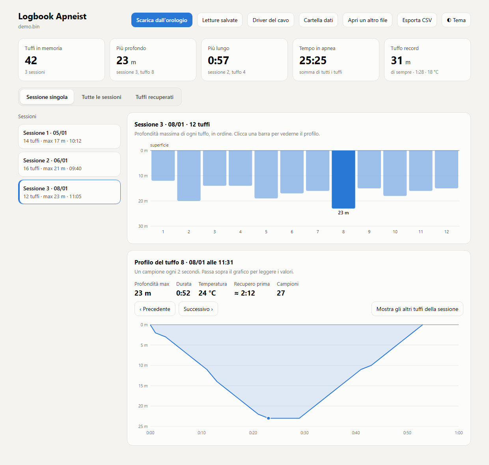
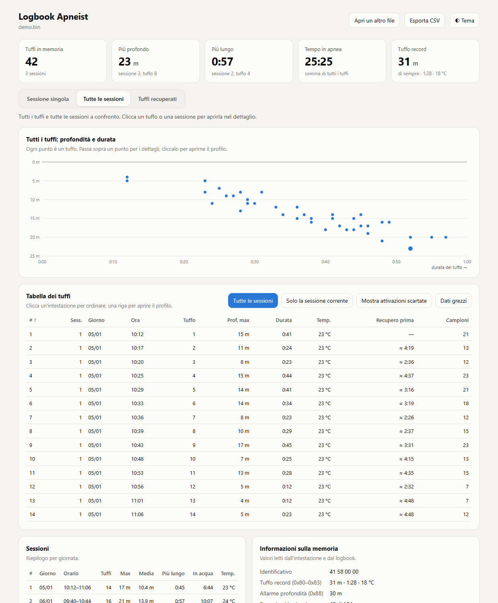
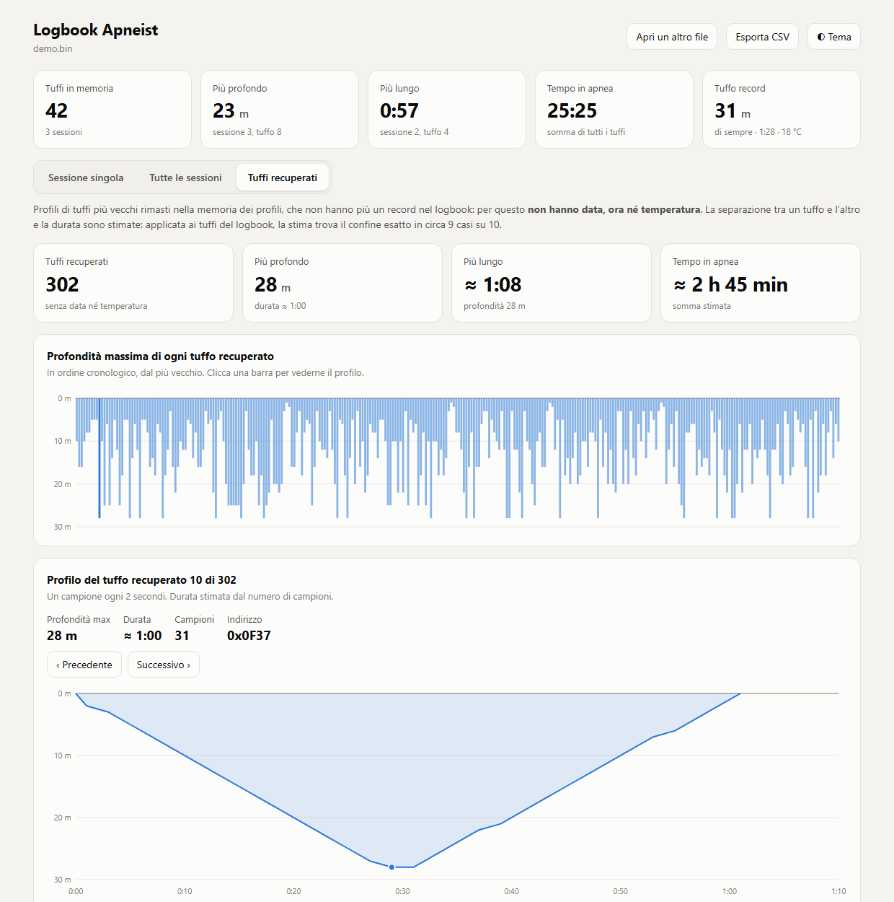

# Logbook Apneist

**Scarica e rivedi i tuffi del tuo vecchio orologio da apnea Mares Apneist (anni '90)**,
con il cavo USB originale, su Windows 10 e 11. Sostituisce il software originale, che
funzionava solo su Windows XP.



<sub>Le schermate usano dati dimostrativi inventati.</sub>

## Cosa fa

- **Scarica la memoria dell'orologio** con un clic e ne salva una copia di backup.
- **Mostra ogni sessione e ogni tuffo**: profondità massima, durata, temperatura, recupero in
  superficie e il profilo profondità/tempo campionato ogni 2 secondi.
- **Recupera i tuffi più vecchi** che l'orologio non elenca più ma che sono ancora nella sua
  memoria dei profili (vedi [Tuffi recuperati](#tuffi-recuperati)).
- **Mostra il tuffo record** che l'orologio conserva: profondità, durata e temperatura.
- **Esporta tutto in CSV** per Excel.
- **Controlla il driver del cavo** e lo installa se serve.
- **Conserva tutte le letture** e le riapre quando vuoi.

L'app invia all'orologio **solo comandi di lettura**: non modifica né cancella nulla.
I dati restano sul tuo computer: l'app non invia niente a nessuno.

> **È il tuo orologio?** Questa app è per il **Mares Apneist anni '90**, quello con la basetta
> a due clip. Il più recente "Mares Nemo Apneist" è un altro modello, già supportato da
> [Subsurface](https://subsurface-divelog.org/).

## Download

**[⬇ Scarica l'ultima versione](https://github.com/J7044/mares-apneist/releases/latest)**,
nella sezione *Assets*:

| File | Quando sceglierlo |
|---|---|
| `Mares-Apneist-portatile.exe` | Non serve installare nulla: lo copi dove vuoi e lo avvii. |
| `Mares Apneist_…_x64-setup.exe` | Installer: aggiunge l'app al menu Start. Non chiede i permessi di amministratore. |

Al primo avvio Windows può mostrare **"Windows ha protetto il PC"**: succede con tutte le app
non firmate digitalmente. Clicca **Ulteriori informazioni → Esegui comunque**.

**Requisiti:** Windows 10 o 11 a 64 bit, l'orologio con il suo cavo USB (chip Prolific
PL2303, ID `067B:2303`). Non serve installare altro.

## Guida rapida

1. **Collega il cavo** al PC, senza l'orologio sulla basetta.
2. **Avvia l'app.** Se il driver del cavo non va bene compare un avviso: premi
   **Sistema il driver** e segui [Il driver del cavo](#il-driver-del-cavo).
3. Premi **Scarica dall'orologio**.
4. **Solo adesso appoggia l'orologio sulla basetta**, con le due clip ben a contatto, e
   tienilo fermo. Sul display compare **PC**.
5. Aspetta: dopo 20-30 secondi parte il download, che dura circa un minuto. Alla fine vedi
   i tuoi tuffi.

> **Perché quest'ordine?** Le clip sono alimentate solo mentre l'app tiene aperta la porta, e
> l'orologio entra in modalità PC quando le tocca già alimentate. Se lo appoggi prima, toglilo
> e rimettilo. L'app aspetta l'orologio fino a 90 secondi.

## Cosa vedi nell'app

### Sessione singola

Le sessioni sono le giornate di immersione. Per ogni sessione vedi la profondità massima di
ogni tuffo e, cliccando una barra, il profilo completo. Le frecce **← →** scorrono i tuffi;
**Mostra gli altri tuffi della sessione** li sovrappone in grigio per confrontarli.

### Tutte le sessioni



Tutti i tuffi a confronto (profondità e durata), la tabella completa e ordinabile, il
riepilogo per giornata, le informazioni lette dall'orologio (tuffo record, allarme di
profondità) e il contenuto esadecimale della memoria.

### Tuffi recuperati



L'orologio elenca solo gli ultimi 100 tuffi circa, ma la sua memoria dei profili è più grande
e contiene ancora i profili di molti tuffi precedenti. L'app li ricostruisce e li mostra qui.

Questi tuffi **non hanno data, ora né temperatura**: quelle informazioni stavano nell'elenco e
sono state sovrascritte. Anche la separazione tra un tuffo e l'altro è stimata. Provata sui
tuffi di cui si conoscono i confini veri, la stima li trova esatti in circa 9 casi su 10.

### Il tuffo record

L'orologio conserva a parte il suo tuffo più profondo di sempre: profondità, durata e
temperatura. Il riquadro **Tuffo record** lo mostra anche quando quel tuffo è troppo vecchio
per avere ancora un profilo in memoria.

## Dove vengono salvati i dati

Tutto finisce nella cartella **Documenti\Mares Apneist**. Il pulsante **Cartella dati** la apre.

| Percorso | Contenuto |
|---|---|
| `dump\apneist_AAAAMMGG_HHMMSS.bin` | Copia completa della memoria dell'orologio, salvata a ogni download. **Conservala**: è il tuo backup. |
| `export\…_tuffi.csv` | Creato con **Esporta CSV**: tuffi, profili e tuffi recuperati, separati da `;`, apribili con Excel. |

**Letture salvate** elenca tutti i download, dal più recente, e li riapre con un clic.
**Apri un file .bin…** (dopo il primo caricamento: **Apri un altro file**) apre un `.bin` da qualsiasi cartella.

## Il driver del cavo

Il cavo usa un chip PL2303 vecchio. I driver Prolific recenti (3.9.x e successivi) lo bloccano:
in Gestione dispositivi la porta compare con un triangolo giallo e il messaggio
*"THIS IS NOT PROLIFIC PL2303. PLEASE CONTACT YOUR SUPPLIER"* (codice 10).
Serve il driver vecchio **3.3.2.102** (del 2008).

Il pulsante **Driver del cavo** mostra:

- se il cavo è collegato e su quale porta COM;
- quale driver sta usando ed eventuali errori;
- se il driver 3.3.2.102 è installato.

### Installare il driver con l'app

1. Procurati il pacchetto del driver Prolific **3.3.2.102**. Prolific non lo distribuisce più,
   quindi va cercato altrove (per esempio il pacchetto "PL2303 Code 10 Fix"). Scaricalo da una
   fonte affidabile e controllalo con l'antivirus.
2. Nell'app premi **Driver del cavo → Installa da un file…** e scegli il file. Va bene un `.zip`
   che contiene `ser2pl.inf`, l'installer `.exe` oppure direttamente `ser2pl.inf`.
3. Windows chiede i permessi di amministratore: servono solo per questa operazione.
4. L'app rimuove i driver Prolific recenti e installa il 3.3.2.102.
5. **Scollega e ricollega il cavo**, poi premi **Ricontrolla**: deve comparire ✅ *Driver corretto*.

### Installarlo a mano

1. Collega il cavo e apri **Gestione dispositivi** → **Porte (COM e LPT)**.
2. Clic destro sulla porta Prolific → **Aggiorna driver** → **Cerca i driver nel computer** →
   **Scegli da un elenco di driver disponibili**.
3. Seleziona la versione **3.3.2.102** (2008), poi scollega e ricollega il cavo.

Windows Update a volte reinstalla il driver nuovo. Se il cavo smette di funzionare, riapri
**Driver del cavo** e ripeti l'installazione.

## Problemi comuni

| Sintomo | Causa probabile e soluzione |
|---|---|
| Avviso sul driver, oppure "Cavo non trovato" | Vedi [Il driver del cavo](#il-driver-del-cavo). Controlla anche che la spina USB sia inserita bene. |
| Non compare "PC" | Togli l'orologio, premi **Scarica dall'orologio** e **poi** riappoggialo. Pulisci le clip e i contatti dell'orologio. |
| Compare "PC" ma il download non parte | Aspetta almeno 30 secondi tenendo fermo l'orologio. Chiudi altri programmi che usano la porta COM. |
| Il cavo sparisce e ricompare | Falso contatto della spina USB: reinseriscila con decisione o prova un'altra porta USB, direttamente sul PC. |
| L'orologio emette suoni, si spegne, si riavvia o dà errori ripetuti | **Pila scarica**: sostituiscila. La modalità PC consuma, quindi evita letture inutilmente lunghe. I tuffi restano in memoria anche quando si cambia la pila. |
| "Windows ha protetto il PC" all'avvio | L'app non è firmata: **Ulteriori informazioni → Esegui comunque**. |

## Senza l'app: script Python e visualizzatore

Il repository contiene anche la versione originale, utile su altri sistemi o per chi preferisce
la riga di comando.

- **`visualizzatore.html`**: aprilo con il browser e trascinaci sopra un file `.bin`. Ha la
  stessa interfaccia dell'app, senza download dall'orologio. Funziona offline.
- **`mares_apneist.py`**: scarica la memoria ed esporta i CSV. Serve
  [Python 3.8+](https://www.python.org/downloads/) con `pip install -r requirements.txt`.
  Su Windows basta il doppio clic su `leggi_orologio.bat`.

```
python mares_apneist.py porte                   # elenca le porte seriali
python mares_apneist.py leggi                   # trova il cavo da solo e scarica la memoria
python mares_apneist.py leggi --porta COM3      # indica tu la porta
python mares_apneist.py analizza dump\FILE.bin  # rianalizza un file salvato, senza orologio
```

Lo script salva in `dump\` (memoria) ed `export\` (CSV), accanto allo script.
`installa_driver.bat` installa il driver se è stato estratto in `C:\PLx64`.

## Provalo senza orologio

[`docs/demo.bin`](docs/demo.bin) è una memoria dimostrativa con dati inventati, la stessa delle
schermate. Aprila nell'app con **Apri un file .bin…**, oppure trascinala su `visualizzatore.html`.

## Limiti noti

- Il formato della memoria è stato ricavato analizzando **un solo esemplare**. Alcuni campi
  sono interpretazioni: in particolare il **mese** della data non è decodificato e l'anno
  non viene salvato, quindi le date mostrano solo il giorno.
- L'orologio elenca solo gli ultimi ~100 tuffi; i più vecchi sopravvivono solo come
  [tuffi recuperati](#tuffi-recuperati), senza data.
- I "tuffi" più brevi di 3 secondi vengono scartati: sono attivazioni accidentali dei contatti.
- Solo Windows: l'app usa il driver e gli strumenti di Windows. Lo script Python dovrebbe
  funzionare anche su Linux e macOS, ma non è stato provato.

## Contribuire

Se hai un Mares Apneist e qualcosa non torna (date, profondità, temperature), apri una
[segnalazione](https://github.com/J7044/mares-apneist/issues). Indica cosa ti aspettavi e cosa
vedi. Non allegare il file `.bin` se non vuoi rendere pubblici i tuoi tuffi: bastano i valori
dei record che non tornano (scheda **Tutte le sessioni → Dati grezzi**).

Due domande aperte, per chi ha l'orologio:

- **Il mese**: il byte che dovrebbe contenerlo vale sempre `01`.
- **"h5"**: un valore che l'orologio mostra insieme al tuffo record e che in memoria non è
  ancora stato trovato.

## Per sviluppatori

| Documento | Contenuto |
|---|---|
| [PROTOCOLLO.md](PROTOCOLLO.md) | Protocollo di comunicazione, mappa della memoria, come sono stati verificati i campi |
| [app/README.md](app/README.md) | Struttura dell'app (Tauri + Rust), compilazione, sezione driver |

L'app è fatta con [Tauri](https://tauri.app/). L'interfaccia è `visualizzatore.html`, che
funziona anche da sola nel browser; la parte in Rust gestisce la porta seriale e il driver.
Le release vengono compilate da GitHub Actions a ogni tag `v*`
(`.github/workflows/release.yml`).

## Crediti

Il protocollo di comunicazione viene da
[libdivecomputer](https://github.com/libdivecomputer/libdivecomputer) (LGPL 2.1), file
`mares_common.c` e `mares_darwin.c`. Il formato della memoria è stato ricavato analizzando
la memoria di un orologio reale.

Mares e Apneist sono marchi dei rispettivi proprietari. Questo progetto non è affiliato a Mares.
